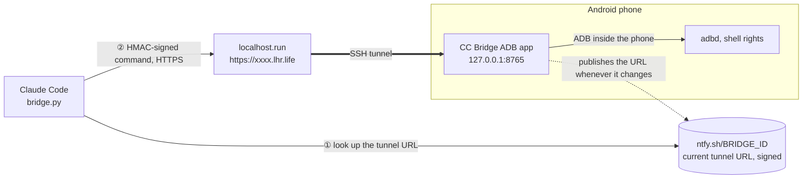

# CC Bridge ADB

[Tiếng Việt](README.md) · **English** · [简体中文](README.zh.md)

[](https://github.com/zenoue/Claude-Code-Bridge-ADB/releases/latest)
[](https://github.com/zenoue/Claude-Code-Bridge-ADB/actions/workflows/build-apk.yml)
[](https://github.com/zenoue/Claude-Code-Bridge-ADB/actions/workflows/live-update.yml)

**Let Claude Code run `adb shell` commands on your Android phone, over the Internet.**
No root · no PC · no account · no server of your own.

> [!WARNING]
> **This is a _vibe-coded_ app.** Most of the source code was written by AI (Claude Code) from the author's
> descriptions and testing, and it has had no independent security review. The app opens a path for remote shell
> commands on a phone, so read the [Security](#security) section, use it only on your own device, and at your own risk.

> [!NOTE]
> The app's interface is in Vietnamese on a Vietnamese phone and in English on any other system language.

## What it does



- **ADB runs inside the app** through Android's *Wireless debugging*, so no root, Shizuku or computer is needed.
- **The app opens its own tunnel** to an `https://…lhr.life` address (localhost.run, no account).
- **Fixed address**: the tunnel URL changes by itself, but you copy the details to Claude Code only **once**.
- **Every command is signed with a password** (HMAC‑SHA256); the password never crosses the network.
- **Features update themselves** from GitHub, without reinstalling the APK.
- **Two languages**: Vietnamese when the phone is set to Vietnamese, English for every other language.

## Quick start

### 1. On the phone (about 3 minutes)

| Step | What to do |
|:---:|---|
| **1** | Download `CCBridgeADB-v1.0.N.apk` from [**Releases**](https://github.com/zenoue/Claude-Code-Bridge-ADB/releases/latest) and install it (it installs over an older version). |
| **2** | Turn on **Wireless debugging**: Settings → Developer options → Wireless debugging. Needs Android 11 or later and a Wi‑Fi connection. |
| **3** | Open the app → **Connect** tab → card *Wireless debugging (ADB)*: **Step 1 – Pair** (port + 6‑digit code; split screen helps you read the code while typing it), then **Step 2 – Connect** (enter the port shown under "IP address & port", or tap *Find the port (mDNS)* to find it automatically). |
| **4** | Tap **Start bridge**. After a few seconds the tunnel URL appears, with the line "✓ The fixed address points to the current tunnel". |
| **5** | Tap **Copy for Claude Code**. |

### 2. In Claude Code

**Paste what you just copied into Claude Code. You do not need to clone this repository.** The pasted block already
contains the command that downloads the client, the address, the password and usage notes written for Claude:

```bash
# Android phone bridge (https://github.com/zenoue/Claude-Code-Bridge-ADB): run `adb shell` commands on my phone.
mkdir -p ~/.ccbridge && curl -fsSL https://raw.githubusercontent.com/zenoue/Claude-Code-Bridge-ADB/main/tools/bridge.py -o ~/.ccbridge/bridge.py
export BRIDGE_ID='ccb-…'                     # fixed address
export BRIDGE_PASSWORD='…'                   # password that signs commands
export BRIDGE_URL='https://xxxx.lhr.life'    # fallback: the tunnel URL at copy time
python3 ~/.ccbridge/bridge.py ping   # always ping first
# Usage: … / Notes: …   (usage, error codes, tips – Claude reads them)
```

Then just ask in plain words, for example:

- "Check my phone's battery. Which app drains the most?"
- "Show error logcat lines from com.example in the last 5 minutes."
- "List the third-party apps installed."

You only copy again after you **change the password** or **change the fixed address**.

> [!NOTE]
> **Claude Code on the web (cloud sessions)** restricts network access to a list of domains. Open the environment
> settings → *Network access* and add `ntfy.sh`, `*.lhr.life` and `raw.githubusercontent.com` (or choose a wider
> access level). [Guide](https://code.claude.com/docs/en/cloud-environments#network-access).
> Claude Code on a computer works right away.

## The app

| Tab | What is there |
|---|---|
| **CLI** | Type `adb shell` commands and see the results. Commands sent by Claude Code appear here too, prefixed with `claude$`, so you always see what Claude is doing. Quick commands, recall the previous command, copy and clear the log. Long output shows only its first and last 40 lines (Claude Code still receives all of it). |
| **Connect** | **Bridge**: start/stop, fixed address, current tunnel URL, *Copy for Claude Code*.<br>**Wireless debugging (ADB)**: pair, connect, *Enable ADB without Wi‑Fi*.<br>**Password & mode**: change the password, change the fixed address, *Allow all commands*.<br>**Feature updates**: check, apply, go back to the version bundled with the APK. |

## `bridge.py` commands

Only Python 3 (standard library) is needed. If you cloned the repository, use `tools/bridge.py` instead of `~/.ccbridge/bridge.py`.

| Command | What it does |
|---|---|
| `bridge.py ping` | Is the app alive, is ADB connected. Always run this first. |
| `bridge.py exec "dumpsys battery"` | Runs a command, prints its output, exits with the command's own exit code. |
| `bridge.py logcat "logcat -v time"` | Follows a logcat stream (Ctrl+C stops watching). Use it for commands that never end. |
| `bridge.py stop-logcat` | Stops the logcat stream on the phone. |
| `bridge.py url` | Prints the current tunnel URL. |
| `bridge.py console` | The app's own log (CLI tab): tunnel and ADB events. |
| `tools/selftest.py` | Self-test of the whole connection and of what ADB can do (needs a clone). |

| Exit code | Meaning |
|:---:|---|
| `0`–`255` | Exit code of the command on the phone |
| `124` | Timed out. Default 90 seconds, set `BRIDGE_TIMEOUT` to change it (10 minutes at most) |
| `1` + `[exit -2]` | Wrong password |
| `1` + `[exit -3]` | Blocked because the app is in read-only mode |
| `1` + `[exit -4]` | ADB is not connected on the phone |
| `1` + `[exit -5]` | The two clocks differ by more than 5 minutes |
| `1` + `[exit -6]` | Duplicate request (the app already received it and will not run it again) |

`no reachable tunnel` means the bridge is not running in the app, or the network blocks `ntfy.sh` / `*.lhr.life`.

## Security

| | |
|---|---|
| **Password** | At least 12 characters; the app generates a random 24-character one. It only signs each command and each address record with HMAC and is **never sent over the network**. Someone who knows the tunnel URL or the `BRIDGE_ID` but not the password only sees the text `CC Bridge ADB`. |
| **Replay protection** | The app rejects a command whose timestamp is off by more than 5 minutes or whose `nonce` was already used. |
| **Read-only mode** | **On by default**, for commands typed in the app and for remote ones: only reading commands are allowed (`dumpsys`, `getprop`, `logcat`, `pm list`…). Turn on *Allow all commands* when you need to write. |
| **Privileges** | Commands run with *shell* rights (uid 2000, like `adb shell`), not root. |
| **Network** | The server inside the app listens on `127.0.0.1` only; it is not exposed to the LAN. |
| **Transparency** | Every remote command shows up immediately in the CLI tab. |

> [!CAUTION]
> localhost.run terminates TLS, so it **can see commands and their output** (it cannot forge commands, as it has no
> password). Do not run commands that print sensitive data. The "Copy for Claude Code" block **contains the
> password**; do not paste it anywhere public.

## Limitations

- **Wi‑Fi**: Android only enables Wireless debugging while on Wi‑Fi (a network without Internet is fine; Internet
  can go through mobile data). Without Wi‑Fi: while ADB is connected, tap *Enable ADB without Wi‑Fi* → adbd opens
  port `5555` on the phone and the app connects to `127.0.0.1:5555`. It then keeps working with Wi‑Fi off, until
  the phone reboots. The first time the phone asks *Allow USB debugging?*, tap Allow. Close this port on public Wi‑Fi.
- **The ADB connect port changes** each time Wireless debugging is toggled or the phone reboots → redo Step 2.
- **Very large output can be cut off by the tunnel** (the free tunnel is speed limited; replies are already
  gzip-compressed). Filter with `| head`, `| tail`, `| grep`, or write to `/data/local/tmp/` on the phone and read it in parts.
- **Battery**: while the bridge is on, the app runs a foreground service and keeps the phone awake. Turn the bridge off when you are not using it.
- **Public services**: it relies on localhost.run (tunnel) and ntfy.sh (fixed address). If ntfy.sh is down, use
  `BRIDGE_URL` for the time being and copy again whenever the tunnel changes.

## Technical details

<details>
<summary><b>Fixed address</b> – why you copy only once</summary>

localhost.run's free tier hands out a random domain that changes on every reconnect and every few hours. So that you do not have to copy again:

- The app generates a secret `BRIDGE_ID` (`ccb-` + 24 characters). Whenever the tunnel gets a new URL, the app posts
  a record to `https://ntfy.sh/<BRIDGE_ID>`: `{"v", "url", "ts", "sig"}` with `sig = HMAC_SHA256(password, "ptr\n<ts>\n<url>")`.
  It posts again every 3 hours (ntfy.sh keeps messages for about 12 hours).
- `bridge.py` tries the URL it remembers (`~/.cache/cc-bridge-adb/`). If that fails it reads
  `ntfy.sh/<BRIDGE_ID>/json?poll=1&since=all`, takes the newest record **with a valid signature**, and sends the command again.
- Resending is safe: every attempt carries the same `nonce`, so the app never runs a command twice.
- Someone who knows the `BRIDGE_ID` but not the password cannot forge a record or run a command (they can only read the tunnel URL).
- If posting to ntfy.sh fails (blocked network…), the app says so in the *Bridge* card; `BRIDGE_URL` still works.

</details>

<details>
<summary><b>The localhost.run tunnel</b></summary>

- Runs inside the app with JSch, equivalent to `ssh -R 80:localhost:8765 nokey@localhost.run -- --output json`.
- The SSH channel is opened **without waiting for a reply** (like OpenSSH): localhost.run may never answer the
  `exec` request, and waiting ends in `channel request: timeout`.
- The URL is read from the `tcpip-forward` JSON event. If no URL arrives within 40 seconds, the next attempt switches to text (shell) mode.
- **Self-check**: every 45 seconds the app calls `GET <url>/health` over the Internet. It only reconnects when that
  URL answered before and then fails 3 times in a row (a phone that cannot reach its own URL does not cycle through addresses).
- **Network change** (Wi‑Fi ↔ mobile data): reconnects at once. Otherwise it reconnects with a 2 s → 30 s backoff.
- **Staying alive**: when the bridge is on and ADB is connected, the app exempts itself from battery optimisation (through ADB).
- Local testing without a phone: `tools/mock_lhr.py` (fake SSH server) + `TunnelLiveTest`.

</details>

<details>
<summary><b>Protocol</b></summary>

`POST {tunnel URL}/cmd` with JSON `{seq, ts, type, cmd, nonce, sig, timeout}` → `{seq, exit, output, next}`.

- `type`: `exec` · `ping` · `logcat_start` · `logcat_stop` · `logs` (cmd = id of the last line read) · `console`.
- `sig = HMAC_SHA256(password, "seq\nts\ntype\nnonce\ncmd")`.
- The app rejects a bad signature (`-2`), a `ts` more than 5 minutes off (`-5`), or a reused `nonce` (`-6`).
- Replies of 1 KB or more are gzip-compressed when the client sends `Accept-Encoding: gzip`.
- `GET /health` returns `CC Bridge ADB`.

</details>

<details>
<summary><b>Self-updating features</b> – no APK reinstall</summary>

All functionality (interface, wireless ADB, tunnel, commands) lives in `feature.dex`, separate from the APK:

```
APK (installed once, from Releases)       `live` branch (pushed by CI whenever feature code changes)
├─ shell MainActivity / BridgeService ◀── live/feature.json {version, api, sha256, file, notes}
├─ FeatureHost: load + update         ◀── live/feature-N.dex
├─ libraries: libadb, jsch, BC, …
└─ assets/feature.dex (fallback copy)
```

- The app checks when it opens, when the bridge starts and every 30 minutes; it downloads the new version, verifies
  SHA‑256 and stores it read-only (required since Android 14). Tap **Apply now** (Connect →
  *Feature updates*) to restart the app; a running bridge starts again by itself.
- The interface is built in code (no XML, no WebView), so even the interface can be updated through `DexClassLoader`.
- A downloaded version that crashes is marked bad and the bundled one is used again; there is also a button *Go back to the bundled version*.
- Downloads try 3 sources in turn: `raw.githubusercontent.com` → `api.github.com` → `cdn.jsdelivr.net`. Each source's error is shown in the update card.
- **A new APK is still needed** when `app/` changes (manifest, permissions, icon, libraries) or `API_VERSION` in `api/` changes.
- Trust: the download comes from the same repository and the same CI as the APK, over HTTPS, with a SHA‑256 check: the same level of trust as the APK file.

</details>

## Development

| Module | Role | When it changes |
|---|---|---|
| `feature/` | All functionality: interface, wireless ADB, tunnel, commands | The app **updates itself** (the *Live update* workflow pushes `feature.dex` to the `live` branch) |
| `app/` | APK shell: Activity/Service, loading and updating the feature, manifest, libraries | A **new APK** must be installed (the *Build APK* workflow publishes release `v1.0.N`) |
| `api/` | Contract between the two (`API_VERSION`) | A new APK must be installed |
| `tools/` | `bridge.py` (Claude Code side), `selftest.py`, `mock_lhr.py` | Usable right away |

```bash
./gradlew testDebugUnitTest   # HMAC, HTTP protocol, fixed address, command filter, end-to-end with tools/bridge.py (needs python3)
./gradlew assembleDebug       # APK + feature/build/outputs/feature/{feature.dex,feature.json}; needs Android SDK 35, JDK 17
```

Only the `main` branch is used; the `live` branch is generated by CI and not edited by hand. Feature version `#N`
is the commit count on `main`, and the notes shown in the app are commit subjects. Conventions are in
[`CLAUDE.md`](CLAUDE.md) (Vietnamese).
