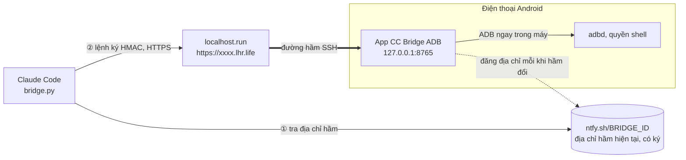

# CC Bridge ADB

**Tiếng Việt** · [English](README.en.md) · [简体中文](README.zh.md)

[](https://github.com/zenoue/Claude-Code-Bridge-ADB/releases/latest)
[](https://github.com/zenoue/Claude-Code-Bridge-ADB/actions/workflows/build-apk.yml)
[](https://github.com/zenoue/Claude-Code-Bridge-ADB/actions/workflows/live-update.yml)

**Cho Claude Code chạy lệnh `adb shell` trên điện thoại Android của bạn, qua Internet.**
Không root · không PC · không tài khoản · không server riêng.

> [!WARNING]
> **Đây là một app _vibe code_.** Mã nguồn chủ yếu do AI (Claude Code) viết theo mô tả và thử nghiệm của tác giả,
> chưa qua kiểm tra bảo mật độc lập. App mở đường cho lệnh shell chạy từ xa trên điện thoại, nên hãy đọc phần
> [Bảo mật](#bảo-mật), chỉ dùng trên máy của chính bạn và tự chịu rủi ro.

## App làm gì



- **ADB chạy ngay trong app** qua *Gỡ lỗi không dây* của Android, nên không cần root, Shizuku hay máy tính.
- **App tự mở đường hầm** ra một địa chỉ `https://…lhr.life` (localhost.run, không cần tài khoản).
- **Địa chỉ cố định**: địa chỉ hầm tự đổi, nhưng bạn chỉ sao chép cho Claude Code **một lần**.
- **Mỗi lệnh được ký bằng mật khẩu** (HMAC‑SHA256); mật khẩu không bao giờ đi qua mạng.
- **Tự cập nhật chức năng** từ GitHub, không phải cài lại APK.

## Bắt đầu nhanh

### 1. Trên điện thoại (khoảng 3 phút)

| Bước | Làm gì |
|:---:|---|
| **1** | Tải `CCBridgeADB-v1.0.N.apk` ở [**Releases**](https://github.com/zenoue/Claude-Code-Bridge-ADB/releases/latest) rồi cài (cài đè được bản cũ). |
| **2** | Bật **Gỡ lỗi không dây**: Cài đặt → Tuỳ chọn nhà phát triển → Gỡ lỗi không dây. Cần Android 11 trở lên và đang nối Wi‑Fi. |
| **3** | Mở app → tab **Connect** → thẻ *Gỡ lỗi không dây (ADB)*: **Bước 1 – Ghép nối** (cổng + mã 6 số; nên chia đôi màn hình để vừa xem mã vừa nhập), rồi **Bước 2 – Kết nối** (nhập cổng ở dòng "Địa chỉ IP và cổng", hoặc bấm *Tự dò cổng (mDNS)*). |
| **4** | Bấm **Bắt đầu cầu nối**. Vài giây sau hiện địa chỉ hầm và dòng "✓ Địa chỉ cố định đã trỏ tới hầm hiện tại". |
| **5** | Bấm **Sao chép cho Claude Code**. |

### 2. Trên Claude Code

**Dán đoạn vừa sao chép vào Claude Code. Không cần clone repo này.** Đoạn đó đã có sẵn lệnh tải công cụ,
địa chỉ, mật khẩu và hướng dẫn sử dụng viết cho Claude:

```bash
# Android phone bridge (https://github.com/zenoue/Claude-Code-Bridge-ADB): run `adb shell` commands on my phone.
mkdir -p ~/.ccbridge && curl -fsSL https://raw.githubusercontent.com/zenoue/Claude-Code-Bridge-ADB/main_1/tools/bridge.py -o ~/.ccbridge/bridge.py
export BRIDGE_ID='ccb-…'                     # địa chỉ cố định
export BRIDGE_PASSWORD='…'                   # mật khẩu ký lệnh
export BRIDGE_URL='https://xxxx.lhr.life'    # dự phòng: địa chỉ hầm lúc sao chép
python3 ~/.ccbridge/bridge.py ping   # always ping first
# Usage: … / Notes: …   (cách dùng, mã lỗi, mẹo – Claude tự đọc)
```

Sau đó cứ yêu cầu bằng lời, ví dụ:

- "Kiểm tra pin điện thoại, app nào đang hao nhất?"
- "Xem logcat lỗi của app com.example trong 5 phút gần đây."
- "Liệt kê các app bên thứ ba đang cài."

Chỉ phải sao chép lại khi bạn **đổi mật khẩu** hoặc **đổi địa chỉ cố định**.

> [!NOTE]
> **Claude Code trên web (phiên cloud)** giới hạn mạng theo danh sách tên miền. Vào cài đặt environment →
> *Network access* và thêm `ntfy.sh`, `*.lhr.life`, `raw.githubusercontent.com` (hoặc chọn mức truy cập rộng hơn).
> [Hướng dẫn](https://code.claude.com/docs/en/cloud-environments#network-access).
> Claude Code trên máy tính thì dùng được ngay.

## Giao diện app

| Tab | Có gì |
|---|---|
| **CLI** | Gõ lệnh `adb shell` và xem kết quả. Lệnh Claude Code gửi tới cũng hiện ở đây với tiền tố `claude$`, nên bạn luôn thấy Claude đang làm gì. Có lệnh nhanh, gọi lại lệnh trước, sao chép và xoá nhật ký. Kết quả dài chỉ hiện 40 dòng đầu và 40 dòng cuối (Claude Code vẫn nhận đủ). |
| **Connect** | **Cầu nối**: bật/tắt, địa chỉ cố định, địa chỉ hầm hiện tại, *Sao chép cho Claude Code*.<br>**Gỡ lỗi không dây (ADB)**: ghép nối, kết nối, *Bật ADB không cần Wi‑Fi*.<br>**Mật khẩu & chế độ**: đổi mật khẩu, đổi địa chỉ cố định, *Cho phép mọi lệnh*.<br>**Cập nhật chức năng**: kiểm tra, áp dụng, quay về bản đi kèm APK. |

## Lệnh của `bridge.py`

Chỉ cần Python 3 (thư viện chuẩn). Nếu đã clone repo thì dùng `tools/bridge.py` thay cho `~/.ccbridge/bridge.py`.

| Lệnh | Tác dụng |
|---|---|
| `bridge.py ping` | App còn sống không, ADB đã kết nối chưa. Luôn chạy trước. |
| `bridge.py exec "dumpsys battery"` | Chạy lệnh, in kết quả, thoát với đúng exit code của lệnh trên máy. |
| `bridge.py logcat "logcat -v time"` | Theo dõi luồng logcat (Ctrl+C để ngừng xem). Dùng cho lệnh không tự kết thúc. |
| `bridge.py stop-logcat` | Dừng luồng logcat trên máy. |
| `bridge.py url` | In địa chỉ hầm hiện tại. |
| `bridge.py console` | Nhật ký của chính app (tab CLI): sự kiện đường hầm, ADB. |
| `tools/selftest.py` | Tự kiểm tra toàn bộ kết nối và khả năng ADB (cần clone repo). |

| Exit code | Ý nghĩa |
|:---:|---|
| `0`–`255` | Exit code của lệnh trên điện thoại |
| `124` | Hết giờ. Mặc định 90 giây, chỉnh bằng `BRIDGE_TIMEOUT` (tối đa 10 phút) |
| `1` + `[exit -2]` | Sai mật khẩu |
| `1` + `[exit -3]` | Bị chặn vì app đang ở chế độ chỉ-đọc |
| `1` + `[exit -4]` | ADB chưa kết nối trên điện thoại |
| `1` + `[exit -5]` | Đồng hồ hai bên lệch quá 5 phút |
| `1` + `[exit -6]` | Lệnh trùng (app đã nhận trước đó, không chạy lại) |

`no reachable tunnel` nghĩa là cầu nối chưa bật trong app, hoặc mạng đang chặn `ntfy.sh` / `*.lhr.life`.

## Bảo mật

| | |
|---|---|
| **Mật khẩu** | Ít nhất 12 ký tự, app tạo sẵn ngẫu nhiên 24 ký tự. Chỉ dùng để ký HMAC từng lệnh và bản ghi địa chỉ, **không bao giờ gửi qua mạng**. Ai biết địa chỉ hầm hay `BRIDGE_ID` mà không có mật khẩu thì chỉ thấy dòng `CC Bridge ADB`. |
| **Chống gửi lại** | App từ chối lệnh có thời gian lệch quá 5 phút hoặc `nonce` đã dùng. |
| **Chế độ chỉ-đọc** | **Bật mặc định**, áp dụng cho cả lệnh gõ tay lẫn lệnh từ xa: chỉ cho các lệnh đọc (`dumpsys`, `getprop`, `logcat`, `pm list`…). Bật *Cho phép mọi lệnh* khi bạn cần ghi. |
| **Quyền** | Lệnh chạy ở quyền *shell* (uid 2000, như `adb shell`), không phải root. |
| **Mạng** | Server trong app chỉ nghe `127.0.0.1`, không lộ ra mạng LAN. |
| **Minh bạch** | Mọi lệnh từ xa đều hiện ngay trong tab CLI. |

> [!CAUTION]
> localhost.run giải mã TLS nên **có thể thấy nội dung lệnh và kết quả** (nhưng không giả được lệnh vì không có
> mật khẩu). Đừng chạy lệnh in ra dữ liệu nhạy cảm. Đoạn "Sao chép cho Claude Code" **có chứa mật khẩu**, đừng
> dán vào nơi công khai.

## Giới hạn

- **Wi‑Fi**: Android chỉ bật Gỡ lỗi không dây khi đang nối Wi‑Fi (mạng không có Internet cũng được, Internet đi qua 4G).
  Không có Wi‑Fi: khi ADB đang kết nối, bấm *Bật ADB không cần Wi‑Fi* → adbd mở cổng `5555` ngay trên máy và app
  nối `127.0.0.1:5555`. Sau đó tắt Wi‑Fi vẫn chạy, cho tới khi khởi động lại điện thoại. Lần đầu máy hỏi
  *Cho phép gỡ lỗi USB?* thì bấm Cho phép. Nên tắt cổng này khi dùng Wi‑Fi công cộng.
- **Cổng kết nối ADB đổi** sau mỗi lần tắt/bật Gỡ lỗi không dây hoặc khởi động lại → làm lại Bước 2.
- **Kết quả quá lớn có thể bị hầm cắt** (hầm miễn phí bị giới hạn tốc độ; kết quả đã được nén gzip). Hãy lọc bằng
  `| head`, `| tail`, `| grep`, hoặc ghi ra `/data/local/tmp/` trên máy rồi đọc từng phần.
- **Pin**: khi cầu nối bật, app chạy dịch vụ nền và giữ máy thức. Tắt cầu nối khi không dùng.
- **Phụ thuộc dịch vụ công cộng**: localhost.run (đường hầm) và ntfy.sh (địa chỉ cố định). ntfy.sh ngừng hoạt động
  thì dùng tạm `BRIDGE_URL` và sao chép lại mỗi khi hầm đổi.

## Chi tiết kỹ thuật

<details>
<summary><b>Địa chỉ cố định</b> – vì sao chỉ cần sao chép một lần</summary>

localhost.run bản miễn phí cấp tên miền ngẫu nhiên, đổi mỗi lần nối lại và sau vài giờ. Để không phải sao chép lại:

- App tự sinh một `BRIDGE_ID` bí mật (`ccb-` + 24 ký tự). Mỗi khi hầm có địa chỉ mới, app đăng một bản ghi lên
  `https://ntfy.sh/<BRIDGE_ID>`: `{"v", "url", "ts", "sig"}` với `sig = HMAC_SHA256(mật_khẩu, "ptr\n<ts>\n<url>")`.
  Đăng lại mỗi 3 giờ (ntfy.sh giữ tin khoảng 12 giờ).
- `bridge.py` thử địa chỉ đã nhớ (`~/.cache/cc-bridge-adb/`). Không được thì đọc
  `ntfy.sh/<BRIDGE_ID>/json?poll=1&since=all`, lấy bản ghi mới nhất **có chữ ký đúng**, rồi gửi lại lệnh.
- Gửi lại an toàn: mọi lần thử dùng cùng một `nonce`, nên app không bao giờ chạy một lệnh hai lần.
- Ai biết `BRIDGE_ID` mà không có mật khẩu: không giả được bản ghi, không chạy được lệnh (chỉ đọc được địa chỉ hầm).
- Không đăng được lên ntfy.sh (mạng chặn…): app báo ngay trong thẻ *Cầu nối*; vẫn dùng được bằng `BRIDGE_URL`.

</details>

<details>
<summary><b>Đường hầm localhost.run</b></summary>

- Chạy ngay trong app bằng JSch, tương đương `ssh -R 80:localhost:8765 nokey@localhost.run -- --output json`.
- Kênh SSH mở **không chờ xác nhận** (như OpenSSH): localhost.run có thể không trả lời yêu cầu `exec`,
  nếu chờ sẽ lỗi `channel request: timeout`.
- Đọc địa chỉ từ sự kiện JSON `tcpip-forward`. Sau 40 giây chưa có địa chỉ thì lần sau chuyển sang chế độ text (shell).
- **Tự kiểm tra**: mỗi 45 giây app gọi `GET <địa chỉ>/health` qua Internet. Chỉ nối lại khi địa chỉ đó từng phản hồi
  rồi hỏng 3 lần liên tiếp (máy không tự gọi được địa chỉ của mình thì không bị đổi địa chỉ liên tục).
- **Đổi mạng** (Wi‑Fi ↔ 4G): nối lại tức thì. Các lần khác nối lại theo backoff 2 giây → 30 giây.
- **Chống bị tắt nền**: khi cầu nối bật và ADB đã kết nối, app tự đưa mình vào danh sách miễn tối ưu pin (qua ADB).
- Thử cục bộ không cần điện thoại: `tools/mock_lhr.py` (server SSH giả) + `TunnelLiveTest`.

</details>

<details>
<summary><b>Giao thức</b></summary>

`POST {địa chỉ hầm}/cmd` với JSON `{seq, ts, type, cmd, nonce, sig, timeout}` → `{seq, exit, output, next}`.

- `type`: `exec` · `ping` · `logcat_start` · `logcat_stop` · `logs` (cmd = id dòng cuối đã đọc) · `console`.
- `sig = HMAC_SHA256(mật_khẩu, "seq\nts\ntype\nnonce\ncmd")`.
- App từ chối nếu chữ ký sai (`-2`), `ts` lệch quá 5 phút (`-5`), hoặc `nonce` đã dùng (`-6`).
- Trả lời từ 1 KB trở lên được nén gzip khi client gửi `Accept-Encoding: gzip`.
- `GET /health` trả `CC Bridge ADB`.

</details>

<details>
<summary><b>Tự cập nhật chức năng</b> – không cần cài lại APK</summary>

Toàn bộ chức năng (giao diện, ADB không dây, đường hầm, lệnh) nằm trong `feature.dex`, tách khỏi APK:

```
APK (cài một lần, từ Releases)            nhánh `live` (CI đẩy mỗi khi code chức năng đổi)
├─ vỏ MainActivity / BridgeService  ◀──── live/feature.json {version, api, sha256, file, notes}
├─ FeatureHost: nạp + cập nhật      ◀──── live/feature-N.dex
├─ thư viện: libadb, jsch, BC, …
└─ assets/feature.dex (bản dự phòng)
```

- App kiểm tra khi mở, khi bật cầu nối và mỗi 30 phút; tải bản mới, kiểm SHA‑256, lưu read‑only (bắt buộc từ Android 14).
  Bấm **Áp dụng ngay** (Connect → *Cập nhật chức năng*) để khởi động lại app; cầu nối đang bật sẽ tự bật lại.
- Giao diện dựng bằng code (không XML, không WebView) nên cập nhật được cả giao diện qua `DexClassLoader`.
- Bản tải về gây lỗi → tự đánh dấu hỏng và quay về bản đi kèm APK; có nút *Quay về bản đi kèm APK*.
- Tải lần lượt qua 3 nguồn, nguồn trước lỗi thì thử nguồn sau: `raw.githubusercontent.com` → `api.github.com` →
  `cdn.jsdelivr.net`. Lỗi của từng nguồn hiện ngay trong thẻ cập nhật.
- **Vẫn phải cài APK mới** khi đổi `app/` (manifest, quyền, icon, thư viện) hoặc `API_VERSION` trong `api/`.
- Tin cậy: bản tải về đến từ cùng repo và cùng CI với APK, qua HTTPS, kiểm SHA‑256, ngang mức tin cậy của file APK.

</details>

## Phát triển

| Module | Vai trò | Đổi thì |
|---|---|---|
| `feature/` | Toàn bộ chức năng: giao diện, ADB không dây, đường hầm, lệnh | App **tự cập nhật** (workflow *Live update* đẩy `feature.dex` lên nhánh `live`) |
| `app/` | Vỏ APK: Activity/Service, nạp và cập nhật feature, manifest, thư viện | Phải **cài APK mới** (workflow *Build APK* tạo release `v1.0.N`) |
| `api/` | Hợp đồng giữa hai bên (`API_VERSION`) | Phải cài APK mới |
| `tools/` | `bridge.py` (phía Claude Code), `selftest.py`, `mock_lhr.py` | Dùng được ngay |

```bash
./gradlew testDebugUnitTest   # HMAC, giao thức HTTP, địa chỉ cố định, bộ lọc lệnh, đầu-cuối với tools/bridge.py (cần python3)
./gradlew assembleDebug       # APK + feature/build/outputs/feature/{feature.dex,feature.json}; cần Android SDK 35, JDK 17
```

Chỉ dùng nhánh `main_1`; nhánh `live` do CI tạo, không sửa tay. Phiên bản chức năng `#N` là số commit trên `main_1`,
ghi chú hiện trong app là tiêu đề commit. Quy ước chi tiết ở [`CLAUDE.md`](CLAUDE.md).
