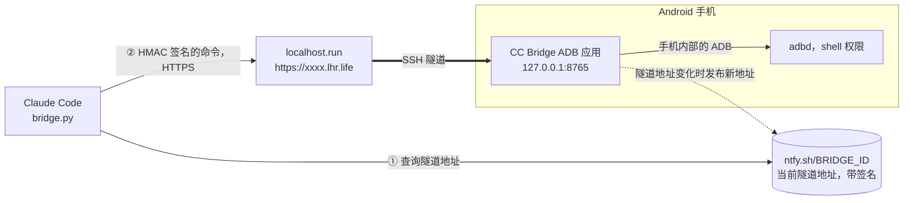

# CC Bridge ADB

[Tiếng Việt](README.md) · [English](README.en.md) · **简体中文**

[](https://github.com/zenoue/Claude-Code-Bridge-ADB/releases/latest)
[](https://github.com/zenoue/Claude-Code-Bridge-ADB/actions/workflows/build-apk.yml)
[](https://github.com/zenoue/Claude-Code-Bridge-ADB/actions/workflows/live-update.yml)

**让 Claude Code 通过互联网在你的 Android 手机上执行 `adb shell` 命令。**
无需 root · 无需电脑 · 无需账号 · 无需自建服务器。

> [!WARNING]
> **这是一个 _vibe coding_ 应用。** 源代码主要由 AI（Claude Code）根据作者的描述和测试编写，没有经过独立的安全审查。
> 本应用为远程 shell 命令打开了一条通往手机的通道，请先阅读[安全](#安全)一节，只在自己的设备上使用，风险自负。

> [!NOTE]
> 应用界面是越南语。下文中的按钮和标签页名称保留越南语原文，并附中文说明。

## 它做什么



- **ADB 直接在应用内运行**，使用 Android 的"无线调试"，不需要 root、Shizuku 或电脑。
- **应用自己建立隧道**，得到一个 `https://…lhr.life` 地址（localhost.run，无需账号）。
- **固定地址**：隧道地址会自动变化，但你只需向 Claude Code 复制**一次**。
- **每条命令都用密码签名**（HMAC‑SHA256），密码本身从不经过网络。
- **功能自动更新**，从 GitHub 下载，不用重装 APK。

## 快速开始

### 1. 在手机上（约 3 分钟）

| 步骤 | 操作 |
|:---:|---|
| **1** | 在 [**Releases**](https://github.com/zenoue/Claude-Code-Bridge-ADB/releases/latest) 下载 `CCBridgeADB-v1.0.N.apk` 并安装（可以覆盖旧版本）。 |
| **2** | 打开**无线调试**：设置 → 开发者选项 → 无线调试。需要 Android 11 及以上，并且已连接 Wi‑Fi。 |
| **3** | 打开应用 → **Connect** 标签页 → *Gỡ lỗi không dây (ADB)* 卡片：**Bước 1 – Ghép nối**（配对：端口 + 6 位配对码，建议分屏，一边看配对码一边输入），然后 **Bước 2 – Kết nối**（连接：输入"IP 地址和端口"一行中的端口，或点 *Tự dò cổng (mDNS)* 自动查找）。 |
| **4** | 点 **Bắt đầu cầu nối**（启动桥接）。几秒后会显示隧道地址，以及一行"✓ Địa chỉ cố định đã trỏ tới hầm hiện tại"（固定地址已指向当前隧道）。 |
| **5** | 点 **Sao chép cho Claude Code**（复制给 Claude Code）。 |

### 2. 在 Claude Code 里

**把刚才复制的内容粘贴到 Claude Code 即可，不需要克隆本仓库。** 这段内容已经包含下载客户端的命令、地址、密码，以及写给 Claude 的使用说明：

```bash
# Android phone bridge (https://github.com/zenoue/Claude-Code-Bridge-ADB): run `adb shell` commands on my phone.
mkdir -p ~/.ccbridge && curl -fsSL https://raw.githubusercontent.com/zenoue/Claude-Code-Bridge-ADB/main/tools/bridge.py -o ~/.ccbridge/bridge.py
export BRIDGE_ID='ccb-…'                     # 固定地址
export BRIDGE_PASSWORD='…'                   # 用于签名命令的密码
export BRIDGE_URL='https://xxxx.lhr.life'    # 备用：复制时的隧道地址
python3 ~/.ccbridge/bridge.py ping   # always ping first
# Usage: … / Notes: …   （用法、错误码、提示，Claude 会自己读）
```

之后直接用自然语言提要求，例如：

- "检查一下我手机的电池，哪个应用最耗电？"
- "看看 com.example 最近 5 分钟的 logcat 错误。"
- "列出已安装的第三方应用。"

只有在**修改密码**或**更换固定地址**之后才需要重新复制。

> [!NOTE]
> **网页版 Claude Code（云端会话）** 按域名白名单限制网络。进入 environment 设置 → *Network access*，添加
> `ntfy.sh`、`*.lhr.life` 和 `raw.githubusercontent.com`（或选择更宽的访问级别）。
> [说明文档](https://code.claude.com/docs/en/cloud-environments#network-access)。
> 电脑上的 Claude Code 可以直接使用。

## 应用界面

| 标签页 | 内容 |
|---|---|
| **CLI** | 输入 `adb shell` 命令并查看结果。Claude Code 发来的命令也会显示在这里，前缀为 `claude$`，所以你随时能看到 Claude 在做什么。有快捷命令、调出上一条命令、复制和清空日志。输出很长时只显示开头和结尾各 40 行（Claude Code 仍然收到完整输出）。 |
| **Connect** | **Cầu nối**（桥接）：启动/停止、固定地址、当前隧道地址、*Sao chép cho Claude Code*。<br>**Gỡ lỗi không dây (ADB)**（无线调试）：配对、连接、*Bật ADB không cần Wi‑Fi*（不需要 Wi‑Fi 的 ADB）。<br>**Mật khẩu & chế độ**（密码与模式）：修改密码、更换固定地址、*Cho phép mọi lệnh*（允许所有命令）。<br>**Cập nhật chức năng**（功能更新）：检查、应用、退回 APK 自带的版本。 |

## `bridge.py` 命令

只需要 Python 3（标准库）。如果已经克隆了仓库，用 `tools/bridge.py` 代替 `~/.ccbridge/bridge.py`。

| 命令 | 作用 |
|---|---|
| `bridge.py ping` | 应用是否在线、ADB 是否已连接。每次先运行它。 |
| `bridge.py exec "dumpsys battery"` | 执行命令，打印输出，并以手机上该命令的退出码退出。 |
| `bridge.py logcat "logcat -v time"` | 跟踪 logcat 流（Ctrl+C 停止查看）。用于不会自己结束的命令。 |
| `bridge.py stop-logcat` | 停止手机上的 logcat 流。 |
| `bridge.py url` | 打印当前隧道地址。 |
| `bridge.py console` | 应用自身的日志（CLI 标签页）：隧道和 ADB 事件。 |
| `tools/selftest.py` | 对整个连接和 ADB 能力做自检（需要克隆仓库）。 |

| 退出码 | 含义 |
|:---:|---|
| `0`–`255` | 手机上命令的退出码 |
| `124` | 超时。默认 90 秒，可用 `BRIDGE_TIMEOUT` 调整（最长 10 分钟） |
| `1` + `[exit -2]` | 密码错误 |
| `1` + `[exit -3]` | 被拦截：应用处于只读模式 |
| `1` + `[exit -4]` | 手机上 ADB 未连接 |
| `1` + `[exit -5]` | 两端时钟相差超过 5 分钟 |
| `1` + `[exit -6]` | 重复请求（应用已收到过，不会再次执行） |

`no reachable tunnel` 表示应用里的桥接没有启动，或者当前网络屏蔽了 `ntfy.sh` / `*.lhr.life`。

## 安全

| | |
|---|---|
| **密码** | 至少 12 个字符，应用会预先随机生成 24 个字符。它只用来对每条命令和地址记录做 HMAC 签名，**从不通过网络发送**。只知道隧道地址或 `BRIDGE_ID` 而没有密码的人，只能看到一行 `CC Bridge ADB`。 |
| **防重放** | 时间戳相差超过 5 分钟，或 `nonce` 已被使用过的命令，应用一律拒绝。 |
| **只读模式** | **默认开启**，对手动输入和远程发来的命令都生效：只允许读取类命令（`dumpsys`、`getprop`、`logcat`、`pm list`……）。需要写入时再打开 *Cho phép mọi lệnh*。 |
| **权限** | 命令以 *shell* 权限运行（uid 2000，与 `adb shell` 相同），不是 root。 |
| **网络** | 应用内的服务器只监听 `127.0.0.1`，不暴露给局域网。 |
| **透明** | 所有远程命令都会立即显示在 CLI 标签页。 |

> [!CAUTION]
> localhost.run 会解密 TLS，所以它**能看到命令和输出内容**（但没有密码，无法伪造命令）。不要执行会打印敏感数据的命令。
> "Sao chép cho Claude Code" 复制的内容**包含密码**，不要粘贴到公开场合。

## 限制

- **Wi‑Fi**：Android 只在连接 Wi‑Fi 时才启用无线调试（没有互联网的 Wi‑Fi 也可以，上网走移动数据）。
  没有 Wi‑Fi 时：在 ADB 已连接的情况下点 *Bật ADB không cần Wi‑Fi* → adbd 在手机上打开 `5555` 端口，应用连接
  `127.0.0.1:5555`。之后关掉 Wi‑Fi 也能用，直到手机重启。第一次手机询问"允许 USB 调试吗？"时点允许。
  使用公共 Wi‑Fi 时应关闭这个端口。
- **ADB 连接端口会变**：每次开关无线调试或重启手机之后，需要重做第 2 步（Bước 2）。
- **输出太大可能被隧道截断**（免费隧道限速；回复已用 gzip 压缩）。请用 `| head`、`| tail`、`| grep` 过滤，
  或者先写到手机的 `/data/local/tmp/` 再分段读取。
- **电量**：桥接开启时，应用运行前台服务并保持手机唤醒。不用时请关闭桥接。
- **依赖公共服务**：localhost.run（隧道）和 ntfy.sh（固定地址）。ntfy.sh 不可用时，可暂时使用 `BRIDGE_URL`，
  隧道地址变化后需要重新复制。

## 技术细节

<details>
<summary><b>固定地址</b> – 为什么只需复制一次</summary>

localhost.run 免费版分配随机域名，每次重连以及每隔几小时都会变化。为了不必重新复制：

- 应用生成一个保密的 `BRIDGE_ID`（`ccb-` + 24 个字符）。每当隧道得到新地址，应用就向
  `https://ntfy.sh/<BRIDGE_ID>` 发布一条记录：`{"v", "url", "ts", "sig"}`，其中
  `sig = HMAC_SHA256(密码, "ptr\n<ts>\n<url>")`。每 3 小时重新发布一次（ntfy.sh 大约保留消息 12 小时）。
- `bridge.py` 先尝试记住的地址（`~/.cache/cc-bridge-adb/`）。不通就读取
  `ntfy.sh/<BRIDGE_ID>/json?poll=1&since=all`，取**签名正确**的最新记录，然后重新发送命令。
- 重发是安全的：每次尝试都带同一个 `nonce`，所以应用绝不会把一条命令执行两次。
- 只知道 `BRIDGE_ID` 而没有密码的人：无法伪造记录，也无法执行命令（只能读到隧道地址）。
- 无法发布到 ntfy.sh（网络屏蔽等）时，应用会在 *Cầu nối* 卡片中提示；仍可通过 `BRIDGE_URL` 使用。

</details>

<details>
<summary><b>localhost.run 隧道</b></summary>

- 在应用内用 JSch 运行，等同于 `ssh -R 80:localhost:8765 nokey@localhost.run -- --output json`。
- SSH 通道打开时**不等待确认**（与 OpenSSH 一样）：localhost.run 可能不回复 `exec` 请求，等待会导致 `channel request: timeout`。
- 从 `tcpip-forward` JSON 事件中读取地址。40 秒内没有拿到地址，下一次改用文本（shell）模式。
- **自检**：应用每 45 秒通过互联网请求一次 `GET <地址>/health`。只有当该地址曾经响应过、之后连续失败 3 次时才重连
  （手机访问不了自己的公网地址时，不会因此不停更换地址）。
- **网络切换**（Wi‑Fi ↔ 移动数据）：立即重连。其他情况按 2 秒 → 30 秒的退避重连。
- **防止被系统杀后台**：桥接开启且 ADB 已连接时，应用会（通过 ADB）把自己加入电池优化白名单。
- 无需手机的本地测试：`tools/mock_lhr.py`（模拟 SSH 服务器）+ `TunnelLiveTest`。

</details>

<details>
<summary><b>协议</b></summary>

`POST {隧道地址}/cmd`，JSON 为 `{seq, ts, type, cmd, nonce, sig, timeout}` → `{seq, exit, output, next}`。

- `type`：`exec` · `ping` · `logcat_start` · `logcat_stop` · `logs`（cmd = 已读到的最后一行的 id）· `console`。
- `sig = HMAC_SHA256(密码, "seq\nts\ntype\nnonce\ncmd")`。
- 签名错误（`-2`）、`ts` 相差超过 5 分钟（`-5`）或 `nonce` 重复（`-6`）时，应用拒绝执行。
- 客户端发送 `Accept-Encoding: gzip` 时，1 KB 及以上的回复用 gzip 压缩。
- `GET /health` 返回 `CC Bridge ADB`。

</details>

<details>
<summary><b>功能自动更新</b> – 不用重装 APK</summary>

全部功能（界面、无线 ADB、隧道、命令）都在 `feature.dex` 中，与 APK 分离：

```
APK（从 Releases 安装一次）               `live` 分支（功能代码变化时由 CI 推送）
├─ 外壳 MainActivity / BridgeService ◀─── live/feature.json {version, api, sha256, file, notes}
├─ FeatureHost：加载 + 更新           ◀─── live/feature-N.dex
├─ 库：libadb、jsch、BC……
└─ assets/feature.dex（备用版本）
```

- 应用在打开时、启动桥接时以及每 30 分钟检查一次；下载新版本，校验 SHA‑256，并以只读方式保存（Android 14 起强制要求）。
  点 **Áp dụng ngay**（立即应用；Connect → *Cập nhật chức năng*）重启应用；正在运行的桥接会自动重新启动。
- 界面完全用代码构建（没有 XML，没有 WebView），所以连界面也能通过 `DexClassLoader` 更新。
- 下载的版本出错时会被标记为损坏，并退回 APK 自带的版本；也有 *Quay về bản đi kèm APK* 按钮。
- 依次尝试 3 个下载源：`raw.githubusercontent.com` → `api.github.com` → `cdn.jsdelivr.net`。每个源的错误都会显示在更新卡片中。
- 修改 `app/`（manifest、权限、图标、库）或 `api/` 中的 `API_VERSION` 时，**仍然需要安装新的 APK**。
- 可信度：下载内容与 APK 来自同一个仓库、同一套 CI，经 HTTPS 传输并校验 SHA‑256，与 APK 文件的可信程度相同。

</details>

## 开发

| 模块 | 作用 | 修改之后 |
|---|---|---|
| `feature/` | 全部功能：界面、无线 ADB、隧道、命令 | 应用**自动更新**（*Live update* 工作流把 `feature.dex` 推送到 `live` 分支） |
| `app/` | APK 外壳：Activity/Service、加载和更新 feature、manifest、库 | 必须**安装新的 APK**（*Build APK* 工作流发布 `v1.0.N`） |
| `api/` | 两者之间的约定（`API_VERSION`） | 必须安装新的 APK |
| `tools/` | `bridge.py`（Claude Code 一侧）、`selftest.py`、`mock_lhr.py` | 直接可用 |

```bash
./gradlew testDebugUnitTest   # HMAC、HTTP 协议、固定地址、命令过滤、与 tools/bridge.py 的端到端测试（需要 python3）
./gradlew assembleDebug       # APK + feature/build/outputs/feature/{feature.dex,feature.json}；需要 Android SDK 35、JDK 17
```

只使用 `main` 分支；`live` 分支由 CI 生成，不要手动修改。功能版本 `#N` 是 `main` 上的提交数，应用内显示的更新说明是提交标题。
详细约定见 [`CLAUDE.md`](CLAUDE.md)（越南语）。
